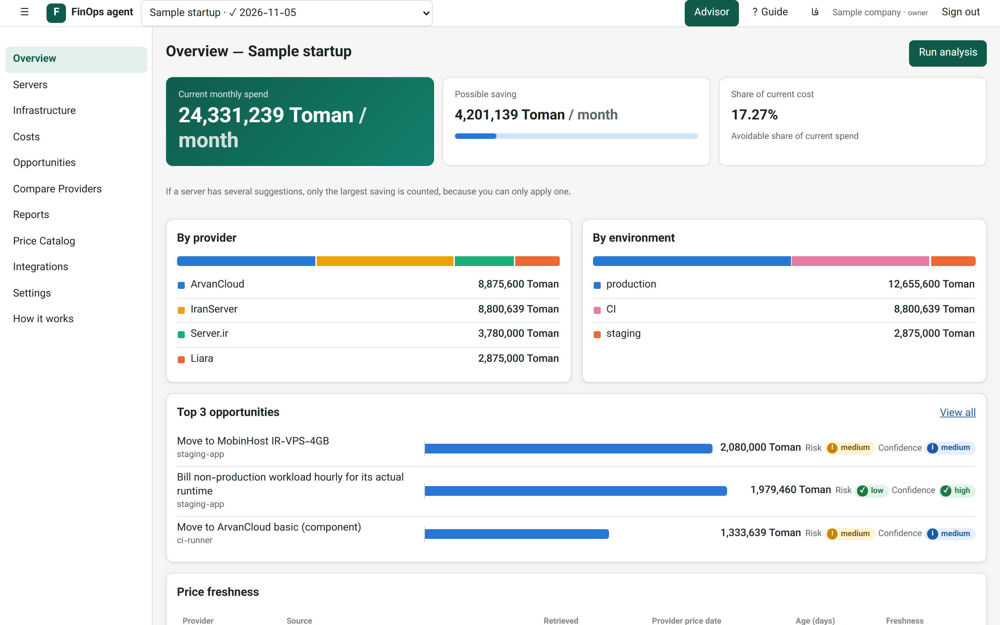
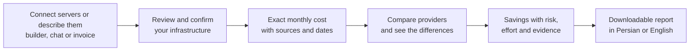
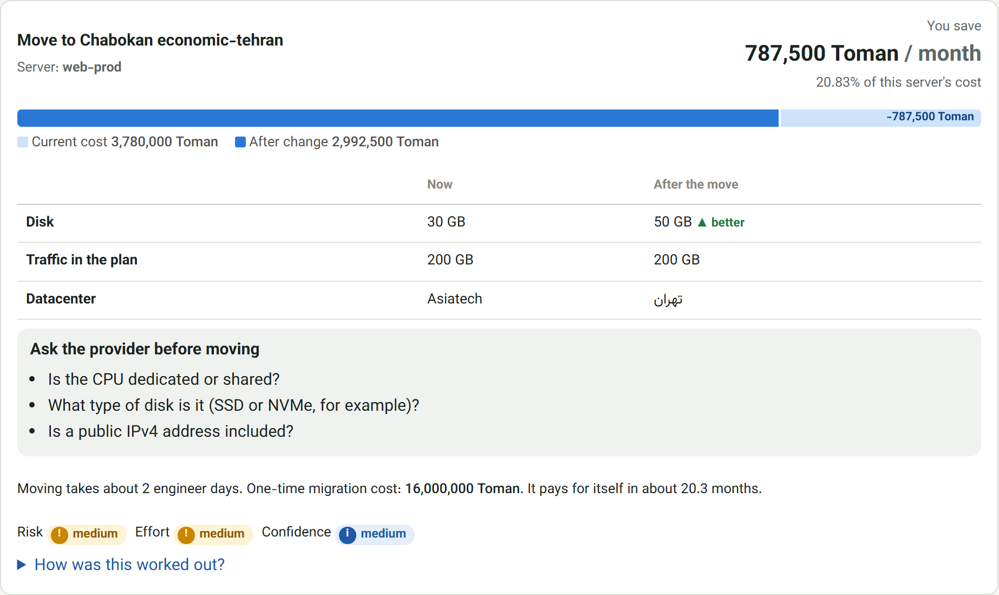

<div align="center">

# FinOps agent

**Know what your Iranian servers really cost, and where you can safely pay less.**

Open-source cost management for startups and small teams using Iranian cloud and VPS providers.
Install it on one server and see the real cost and usage of all of them.

[](https://github.com/theparsakhezli/FinOps_agent/actions/workflows/ci.yml)
[](https://github.com/theparsakhezli/FinOps_agent/releases/latest)
[](LICENSE)


[Quick start](#quick-start) · [How it works](#how-it-works) · [Providers](#supported-providers) · [Roadmap](#roadmap) · [فارسی](#فارسی)

</div>

<p align="center"><br><sub>Sample data</sub></p>

---

## Why FinOps agent?

Iranian providers price their services in very different ways: per component, per plan, per hour or per
30 days, each with its own traffic rules. Comparing them by hand is slow, and it's easy to get wrong.

FinOps agent turns your servers, or just a description of your infrastructure, into exact costs, a like-for-like
comparison and savings you can check yourself. You don't need Terraform, tagging or cloud credentials.

- 🖥️ **One installation, all your servers.** Real usage is read over SSH with a key that can only run one read-only script.
- 🔔 **Hear about changes.** Get alerts by email or Bale when prices change or a renewal is close.
- 🧮 **Numbers you can trust.** Every price and saving comes from tested code, and the AI never calculates one.
- 🔍 **Nothing is guessed.** A missing price shows as `PRICE_UNAVAILABLE`, never as an estimate.
- 📅 **Every price has a source.** Each one links to the provider's page and shows its date, and old prices are kept.
- ✅ **You stay in control.** You confirm your infrastructure before anything is priced.
- ⚖️ **Honest comparisons.** Differences in CPU, disk, traffic and datacenter are always shown.
- 🔌 **Works offline.** The AI features are optional, and the app runs without any external AI service.
- 🇮🇷 **Built for Iran.** Toman and Rial, Jalali price dates, and a right-to-left Persian interface, with English too.

## Quick start

**Install on a server:**

```bash
git clone https://github.com/theparsakhezli/FinOps_agent.git
cd FinOps_agent
sudo ./install.sh --domain finops.example.ir
```

Then open your domain, create the first account, and add your other servers from the **Servers** page. If Docker Hub
isn't reachable from your server, download the offline bundle from the [latest release](https://github.com/theparsakhezli/FinOps_agent/releases/latest),
or [use a mirror](docs/installation.md#if-foreign-registries-are-blocked).

**Or try it on your computer** with [Docker](https://docs.docker.com/get-docker/):

```bash
cp .env.example .env
docker compose up --build
```

Open <http://localhost:8080> and sign in with the demo account, then choose **Load demo workspace**:

```text
demo@finops-agent.local / demo-password-1
```

> The demo account exists only in development mode, and this setup is reachable only from your own computer.

<details>
<summary><b>Run without Docker</b> (SQLite, Python 3.12+, Node 20+)</summary>

```bash
make install
make api      # http://localhost:8000/docs
make web      # http://localhost:5173 (in a second terminal)
```

On Windows without `make`, use `.\scripts\finops.ps1 <target>` with the same target names.

</details>

## How it works



1. **Add your setup.** Connect your servers, or use the guided builder, a chat message in Persian or English, or a
   PDF or CSV invoice.
2. **Confirm it.** An editable table shows anything uncertain, and analysis stays locked until you confirm.
3. **See your costs.** Each quote is saved permanently, with the catalog version and source of every line.
4. **Compare providers.** Plans must pass hard requirements before they count as equivalent. Low-confidence
   matches are marked `NEEDS_HUMAN_REVIEW`.
5. **Act on savings.** Recommendations cover scheduling, downsizing, migration payback and billing period, and
   say clearly when there isn't enough data to decide. Each one shows what changes and what to ask the new provider:

<p align="center"></p>

## Supported providers

| Provider | Prices in the catalog | Automatic price updates |
|---|---|---|
| Liara | ✅ Exact | ✅ Scraper |
| Server.ir | ✅ Exact | ✅ Scraper |
| IranServer | ✅ Exact (General Purpose plans) | ✅ Scraper |
| ArvanCloud | ✅ Exact | ⚠️ [Updated by hand](docs/provider-adapters.md#updating-prices-by-hand), because the site's bot protection blocks scraping |
| Chabokan | ✅ Exact | ✅ Scraper |
| MobinHost | ✅ Exact | ✅ Scraper |
| ParsPack | ✅ Exact, priced from a server's specs | ✅ Scraper |
| Abrha | ℹ️ Starting price only, never used for savings | ❌ |

Scrapers check official pages twice a day. If a page can't be read, or prices move too sharply, nothing is
applied and the problem shows up in the app.

Spotted a wrong price? [Report it](../../issues/new?template=wrong-price.md).

## Configuration

Settings live in `.env`, and [`.env.example`](.env.example) lists all of them. These are the main ones:

| Setting | Default | Purpose |
|---|---|---|
| `FINOPS_ENV` | `dev` | `dev`, `staging` or `prod`. Production won't start with default secrets. |
| `FINOPS_AI_PROVIDER` | `offline` | `offline` makes no external calls. `anthropic` uses Claude, if it's available to you. |
| `FINOPS_ALLOW_REGISTRATION` | `false` | Open sign-up. The first account can always register, and admins add the rest. |
| `FINOPS_INVOICE_RETENTION_DAYS` | `30` | How long uploaded invoices are kept before deletion. |
| `FINOPS_CATALOG_URL` | none | Use a [shared signed price catalog](docs/installation.md#sharing-one-price-catalog) instead of scraping. |

## Project layout

```text
apps/api        FastAPI service: auth, catalog, inventory, analysis, reports
apps/worker     Scheduled price updates, server collection, alerts and cleanup
apps/web        React and TypeScript dashboard
packages/       Pricing, recommendations, scrapers, server monitoring, AI and invoice parsing, independent of the web framework
data/seeds      Starting price catalog and engine rules
docs/           Architecture, pricing model, scrapers, AI safety and operations
```

## Roadmap

- [x] Exact pricing engine with price history
- [x] Provider comparison and evidence-backed recommendations
- [x] Chat and invoice input, and reports in Persian and English
- [x] One-command installer and offline bundle
- [x] Read-only monitoring of all your servers from one installation
- [x] Server dashboard with real usage, wasted spend and renewal dates
- [x] Price change and renewal alerts by email and Bale
- [x] Shared, signed price catalog
- [ ] An exact catalog for ArvanCloud through its API
- [ ] An optional small agent for servers behind NAT
- [ ] Warn when a provider changes a plan's specs but keeps its name
- [ ] Check totals against real invoices, with help from users

## Documentation

- **How it works:** the app explains its own calculations at `/how-it-works`, in Persian and English
- [Installation](docs/installation.md)
- [Monitoring your servers](docs/servers.md)
- [Architecture](docs/architecture.md)
- [Pricing model](docs/pricing-model.md)
- [Provider scrapers](docs/provider-adapters.md)
- [AI safety](docs/ai-safety.md)
- [Operations and production](docs/runbook.md)
- [Releasing](docs/releasing.md)
- [Changelog](CHANGELOG.md)

## Contributing

Contributions are welcome, especially new provider scrapers and price corrections. Please read
[CONTRIBUTING.md](CONTRIBUTING.md) first, and report security problems as described in [SECURITY.md](SECURITY.md).

## License

[Apache License 2.0](LICENSE)

---

<div dir="rtl">

## فارسی

**FinOps agent** یک ابزار متن‌باز برای مدیریت هزینه زیرساخت است، مخصوص استارتاپ‌ها و تیم‌های کوچکی که از ارائه‌دهندگان ابری و VPS ایرانی استفاده می‌کنند.

آن را روی یک سرور نصب می‌کنید و سرورهای دیگر را از داشبورد اضافه می‌کنید، یا زیرساخت خود را با فرم، چت یا فاکتور وارد می‌کنید. پس از تأیید، هزینه دقیق، مقایسه ارائه‌دهندگان و پیشنهادهای صرفه‌جویی را همراه با منبع و تاریخ قیمت می‌بینید.

- همه قیمت‌ها و صرفه‌جویی‌ها با کد آزموده‌شده محاسبه می‌شوند و هوش مصنوعی هیچ عددی را محاسبه نمی‌کند.
- اگر قیمتی موجود نباشد، به‌جای حدس زدن، نبود آن را نشان می‌دهیم.
- دسترسی به سرورها فقط خواندنی است و کلید SSH فقط می‌تواند یک اسکریپت خواندنی را اجرا کند.
- برنامه بدون سرویس خارجی هوش مصنوعی هم کار می‌کند.

برای شروع، بخش [Quick start](#quick-start) را دنبال کنید.

</div>
