# Pendar redesign

> Since 0.3.0 the landing page is not part of the app: it moved to the public website in `site/`, which an
> installation never serves. The record below is of the redesign as it was done, when the landing page was still in
> `apps/web`.

The web app (`apps/web`) is restyled to follow the Pendar design system, version 3, from Specimen. This is a visual
redesign only: routes, API calls, data handling, validation, permissions and business logic don't change.

Sources read before any code was written: Pendar's brand record and every guideline page as published on 2026-11-07:
about (v1), logo (v1), symbol (v2), colour (v1), type (v1), icons (v3), motion (v1), voice (v2), products (v3),
setup (v5), buttons, fields, choices, navigation, overlays, feedback, display, shopping-and-flows (all v1), social (v3),
stationery, email-signature and launch-screen (v1). The component reference images (Components and Examples
collections) were used to match layout and spacing.

## 1. Audit (before)

### Stack

React 18, TypeScript and Vite, with React Router and TanStack Query. Styling is plain CSS: there is no Tailwind and no
component library. `index.html` and `lib/i18n.tsx` set `lang` and `dir` on `<html>` (Persian by default, English as
an option).

| File | Lines | Hex / rgb literals | px values | font/radius/shadow/motion declarations |
|---|---|---|---|---|
| `src/styles.css` | 1131 | 32 | 83 | 56 |
| `src/experience.css` | 1106 | 87 | 117 | 99 |
| `src/review.css` | 1026 | 14 | 101 | 94 |
| `src/lib/viz.ts` | 38 | 1 (comment) | 0 | 1 |
| `src/components/viz.tsx` | | 0 | 2 | |
| `src/pages/Landing.tsx` | | 0 | 1 | 6 inline style declarations |

### Theme

- One `:root` palette in `styles.css`: `--bg`, `--surface`, `--surface-2`, `--text`, `--muted`, `--border`, `--brand`
  (green), `--brand-ink`, `--brand-soft`, `--good`/`--warn`/`--bad`/`--info` with `-bg` pairs, `--low-conf`,
  `--radius` (10px), `--shadow`, `--font`, `--nav-w` (220px) and `--topbar-h` (56px).
- `experience.css` adds a chart palette (`--series-1`…`--series-8`, `--series-other`) and chart roles
  (`--viz-accent`, `--viz-accent-track`, `--viz-accent-ink`, `--viz-deemph`, `--viz-grid`, `--viz-ink-2`, `--viz-ink-3`).
- Most used: `--border` (42), `--surface` (30), `--bad` (30), `--surface-2` (26), `--brand` (26), `--muted` (23).
- No dark mode. `index.html` declares `color-scheme: light`, and there is no theme switch.
- Rounded corners everywhere (10px cards, pill-shaped badges and chips) and shadows on cards.

### Type

Vazirmatn 400/500/700 from `@fontsource/vazirmatn`, at a 15px base size and line height 1.6. Headings are set in
`rem` (1.45, 1.12, 1, 0.95). Code uses `ui-monospace, Consolas, monospace`.

### Icons and brand marks

- Status and actions use Unicode characters: ✓ ✕ ✗ ! i • ⚠ ⓘ ▲ ▼ ≠ ☰ ↻ Σ ▸ ▾ ← → (30 places in 14 files).
- Two hand-drawn inline SVG sets: `ServiceIcon` (server, database, storage, cloud) in `components/records.tsx`, and
  the feature icons on `pages/Landing.tsx`.
- A letter in a green square stands in for the logo ("F" in the app bar, "P" on the landing page). `public/favicon.svg`
  is a green square with a "P".

### RTL, focus and motion

- Six physical properties (`left`, `right`, `padding-left`, `padding-right`, `text-align: right`) in `review.css` and
  `experience.css`. Everything else already uses logical properties.
- Focus: a 2px green outline on `:focus-visible`.
- Reduced motion: respected in `experience.css` and `lib/viz.ts`.

### Routes

Public: `/welcome` (landing), `/how-it-works`, `/login`, `/register`. Signed in: `/` (overview), `/servers`,
`/infrastructure`, `/costs`, `/opportunities`, `/compare`, `/reports`, `/catalog`, `/integrations`, `/guide`,
`/settings`.

### Shared components

- `components/ui.tsx`: Button, Badge, StatusChip, Card, Loading, Empty, Field, Tabs, Drawer, Money, Num, Pct,
  PriceUnavailableBadge, FreshnessBadge, SourceInfo, LinesTable, ErrorBox, ToneBadge, ReviewBadge.
- `components/records.tsx`: record lists and rows, ServiceIcon, ConfidenceRing, Initial (avatar).
- `components/viz.tsx`: ShareBar, RankedBars, BeforeAfter, PartMeter, tooltips.
- `components/Layout.tsx` (app bar, side navigation), `Tour.tsx`, `Advisor.tsx` (chat drawer), `Builder.tsx`,
  `ReviewTable.tsx`, `Guard.tsx`.

Before screenshots, light theme, desktop (1440px) and phone (390px): [`pendar-redesign/before/`](pendar-redesign/before/).

## 2. Plan

**No new libraries.** Pendar's own components live in `@pendar/ui`, which needs Tailwind 4. Both would be new
dependencies, so the app's existing components are restyled in place. Pendar's `tokens.css` is used directly, with no
Tailwind or JS token files, and the component images in Specimen serve as the visual reference.

1. **Pull.** `scripts/pull-pendar.sh` downloads, with `?version=3`: `tokens.css`, the Estedad variable font (plus its
   OFL license), the icons (generated into one sprite and a list of icons that mirror), the favicons and apple touch
   icon, and the wordmark and symbol paths. Everything is committed. The running site never calls Specimen.
2. **Foundation.** Import `tokens.css` first. Add `@font-face` for Estedad with `font-display: swap`, and remove
   `@fontsource/vazirmatn`. Dark mode follows the system through the tokens' own media query, with `data-theme` on
   `<html>` overriding it. Rebuild the base styles from type tokens: body (16px, line height 1.8, no letter spacing),
   headings (700–900), links, focus ring (`--color-focus`), selection, scrollbars, and `color-scheme`.
3. **Components.** Map every colour to a role:

   | Old | Pendar role |
   |---|---|
   | `--bg` | `--color-surface-page` |
   | `--surface` | `--color-surface-raised` |
   | `--surface-2` | `--color-surface-sunken` (table heads, wells) or `--color-surface-plaster` (brand band, avatars) |
   | `--text`, `--muted` | `--color-ink-default`, `--color-ink-muted` |
   | `--border` | `--color-line-default`; field and control borders use `--color-line-control` |
   | `--brand` (buttons, current nav item) | `--color-action-default` / `-hover` / `-pressed`, `--color-ink-action`, `--color-action-subtle` |
   | `--brand` (focus, selection, progress) | `--color-focus`, `--color-accent-*` |
   | `--good` / `--warn` / `--bad` / `--info` | `--color-success-*`, `--color-warning-*`, `--color-danger-*`, `--color-info-*` |

   Corners use `--radius-control` (2px) and `--radius-card` (4px). Cards, tables and lists become flat with a line,
   and only overlays keep a shadow (`--shadow-overlay`). Controls are 44px tall and 36px in dense bars, from spacing
   tokens. Icons replace the Unicode characters and inline SVGs, at 24px with 8px beside text, mirrored in English
   when the file says so. Motion uses the duration and ease tokens: buttons press down 1px, and nothing loops except
   the loader.
4. **Brand.** The app bar and public pages carry the product lockup: Pendar wordmark, a thin rule, then the product
   name in Estedad 800, drawn in code from `--color-logo-brick` and `--color-logo-glaze` so dark mode reverses it.
   Pendar's favicons replace the old one, the loader becomes the glazing wall, and «قدرت‌گرفته از پندار» goes at the
   foot of the pages (voice guideline).
5. **Pages.** Go through every route, replace what's left, and remove unused CSS.
6. **Verify.** Build, type-check, lint and tests. Every page in light and dark, at 1440px and 390px, in RTL. No request
   to Specimen from the running site.

Known gaps already visible in the tokens: no chart palette, no layout widths (side navigation, content and drawer
width, breakpoints), no scrim colour for overlays, and no border-width or focus-ring-width tokens. Section 3 records
what was done for each.

## 3. Report

### What changed

- **Design system in the repo.** `scripts/pull-pendar.sh` (with `scripts/pendar_assets.py`) downloads Pendar version 3
  from Specimen and writes `apps/web/src/pendar/` (tokens, Estedad with its OFL license, the icon sprite and mirror
  list, the wordmark and symbol paths) and the favicons in `apps/web/public/`. The key stays on the developer's
  machine. The built site contains no Specimen address and no key, and makes no request outside its own origin.
- **Foundation.** `tokens.css` is imported first, and Estedad is self-hosted with `font-display: swap`. The
  `@fontsource/vazirmatn` dependency is removed. The page follows the system's dark mode through the tokens' own media
  query, and `data-theme` on `<html>` overrides it. The app had no theme switch, so none was added. Base styles are
  rebuilt from tokens: body text at 16px with line height 1.8 and no letter spacing, headings at weights 700–900,
  links, the focus ring, selection, scrollbars, `color-scheme` and reduced motion.
- **Brand.** Every page shows the product lockup (Pendar's wordmark, a thin rule, then the product name in Estedad 800),
  drawn from the generated paths in `--color-logo-brick` and `--color-logo-glaze`, so dark mode reverses it. English
  screens use the Latin wordmark. Pendar's favicons and apple-touch icon replace the old ones. Waits show Pendar's wall
  with its tiles glazing in turn. «قدرت‌گرفته از پندار» sits at the foot of the app and the landing page.
- **Icons.** Every Unicode symbol (✓ ✕ ⚠ ⓘ ▲ ▼ ☰ ↻ Σ ▸ ← ↗ ⬇ ● …) and both hand-drawn SVG sets are replaced by
  Pendar icons through one `Icon` component. Icons are 24px beside text and 12px inside badges (one pixel per brick, so
  the edges stay sharp). Directional icons mirror in English, and nothing else does.
- **Components.** Buttons follow the buttons guideline: brick primary, outlined secondary, quiet, and solid red danger,
  at 44px (36px in tables, lists and the app bar), pressing down 1px. Fields get a visible label and a 44px box with
  the control line. Badges and status chips use small corners and the status roles. Alerts have a coloured line at the
  start. The selected tab has a brick line. Cards, tables, lists and the stat tiles are flat with a sand line, and
  table heads sit on the sunken surface over a control line. The side navigation has icons and a brick bar on the
  current item. The switch has a square thumb and turns brick when on. Overlays (drawer, tooltip, tour, the floating
  action bar) are the only things with a shadow. Bars in charts and meters are drawn as bricks, like Pendar's chart and
  meter.
- **Pages.** The landing page drops its gradients, blurred shapes, glass buttons, looping logo strip and scroll
  animations. It now uses the plaster brand band, flat cards and an umber closing band. The overview's headline figure
  sits on the umber tile instead of a green gradient. The reports page keeps one primary button. Nineteen selectors for
  classes nothing uses were removed. Routes, API calls, data handling and permissions are unchanged.

### Files touched

`scripts/pull-pendar.sh`, `scripts/pendar_assets.py` (new); everything in `apps/web/src/pendar/` and the favicons in
`apps/web/public/` (generated); `apps/web/index.html`, `package.json`, `package-lock.json`, `src/main.tsx`;
`src/styles.css`, `src/experience.css`, `src/review.css`; `src/components/Icon.tsx` and `Brand.tsx` (new), `Layout.tsx`,
`ui.tsx`, `viz.tsx`, `ReviewTable.tsx`, `Builder.tsx`, `Advisor.tsx`; `src/pages/Landing.tsx`, `Login.tsx`,
`HowItWorks.tsx`, `Opportunities.tsx`, `Costs.tsx`, `Catalog.tsx`, `Servers.tsx`, `Settings.tsx`, `Integrations.tsx`,
`Reports.tsx`; `src/lib/i18n.tsx` (new strings: «پیش‌نویس», «رفتن به محتوا», «قدرت‌گرفته از پندار», the check labels).

### Tokens by role

| UI role | Tokens |
|---|---|
| Page, cards, wells, brand band | `--color-surface-page`, `-raised`, `-sunken`, `-plaster` |
| Headline tile, closing band, tooltips | `--color-surface-inverse` with `--color-ink-inverse` |
| Text, secondary text, links | `--color-ink-default`, `--color-ink-muted`, `--color-ink-link` |
| Lines and dividers; field and button outlines | `--color-line-default`; `--color-line-control` |
| Primary button, current nav item, selected tab | `--color-action-default` / `-hover` / `-pressed`, `--color-action-subtle`, `--color-ink-action`, `--color-ink-on-action` |
| Focus ring, progress, "new" | `--color-focus`, `--color-accent-default` / `-strong` / `-soft` |
| Errors, warnings, success, information | `--color-danger-*`, `--color-warning-*`, `--color-success-*`, `--color-info-*` |
| Logo and loader | `--color-logo-brick`, `--color-logo-glaze`, `--duration-glaze`, `--ease-glaze` |
| Type | `--font-sans`; `--type-display`, `--type-heading-large/medium/small`, `--type-body-large/default/small`, `--type-action`, `--type-label`, `--type-caption`; `--font-weight-*` |
| Spacing | `--spacing-1` … `--spacing-20` for padding, gaps, offsets, icon and control sizes |
| Corners, shadow | `--radius-control`, `--radius-card`; `--shadow-overlay` (overlays only) |
| Motion | `--duration-quick` / `-base` / `-slow` / `-exit` / `-stagger` / `-lay` / `-glaze`; `--ease-standard` / `-enter` / `-exit` / `-settle` (brand moments only) / `-glaze` |

### What Pendar didn't cover, and what was done instead

| Need | No token for | Done instead |
|---|---|---|
| Chart series (one colour per provider and environment) | A chart palette | Steps of Pendar's own ramps: brick, turquoise and umber at 600, 300 and 900 (dark: 400, 200, 700). The status hues are left out, because the colour guideline keeps them for status. Every chart also prints labels and exact values. Worth asking the design-system team for chart tokens. |
| Overlay backdrop and tour spotlight | A scrim colour | `--scrim`: `--color-neutral-950` at 45% (`color-mix`). |
| Control heights 44/36/52px, icon frame 24px | Size tokens | Built from spacing tokens (`--spacing-10` + `--spacing-1`, and so on), as the buttons and icons guidelines give them. |
| Lockup proportions | Tokens | Measured in bricks, exactly as the products guideline states (1.5, 0.2 by 4, 3.2 bricks, rule at 35%). |
| Loader and logo tile delays | A tile-gap token | `--glaze-gap`: ten `--duration-lay` (250ms), the gap the symbol guideline and Pendar's animated logo use. |
| Entrances on the public pages | A duration above `--duration-slow` | `--duration-brand`: `--duration-slow` × 2.5 (800ms), as pendarsolutions.ir uses for its hero. Only on the landing page; the app stays within 120–320ms. |
| Hairlines and the focus ring | Border-width tokens | 1px lines; 2px focus ring with a 2px offset. |
| Layout | Width and breakpoint tokens | The existing values are kept: side navigation (232px), drawers (460px, 900px), sign-in card, inventory picker, form and chart columns, and breakpoints at 960, 900, 760, 640 and 600px. |
| Dimmed legend items, hidden inputs | Opacity tokens | `opacity` 0.35 and 0.65 in two places, and 0 for visually hidden inputs. |
| Physical sides on purpose | | The tour spotlight is placed from script in viewport coordinates (`left`/`top`). The unit label inside number fields stays on the right, because number fields are left to right in both languages. |

### Verification

- Type-check and production build pass, all 196 Python tests pass, and `ruff` and `shellcheck` are clean. The web
  app has no lint script and no tests of its own.
- **Hard-coded values.** A scan of the app's CSS and TSX (outside the generated `src/pendar/`) finds no colour
  literals and no font other than `--font-sans`. Every `var(--…)` the app references is defined.
- **Every route.** All 14 routes, in light and dark, at 1440px and 390px, in RTL: no horizontal overflow; the
  catalog's filter row scrolls sideways on phones by design.
- **Behaviour,** in a scripted browser session (22 checks, all passing): the sign-in form submits and opens the app.
  Navigation works. "Calculate cost" and "Run analysis" call the same API endpoints as before, and the data loads.
  The drawer closes with Escape and returns focus. Keyboard focus shows the ring. English turns the page left to right
  and mirrors only the directional icons. Dark mode follows the system, and `data-theme` overrides it.
- **Network.** 136 requests recorded: none left the app's own origin, none went to Specimen, none carried a key,
  none failed, and there were no console errors.
- **Contrast.** Every colour pair the app combines itself is at least 4.5:1 for text and 3:1 for lines and focus,
  in both themes. Pendar validates its own token pairs.

Before: [`pendar-redesign/before/`](pendar-redesign/before/). After: [`pendar-redesign/after/`](pendar-redesign/after/)
(light at 1440px and 390px for nine pages, dark for four).

| | Before | After |
|---|---|---|
| Landing | 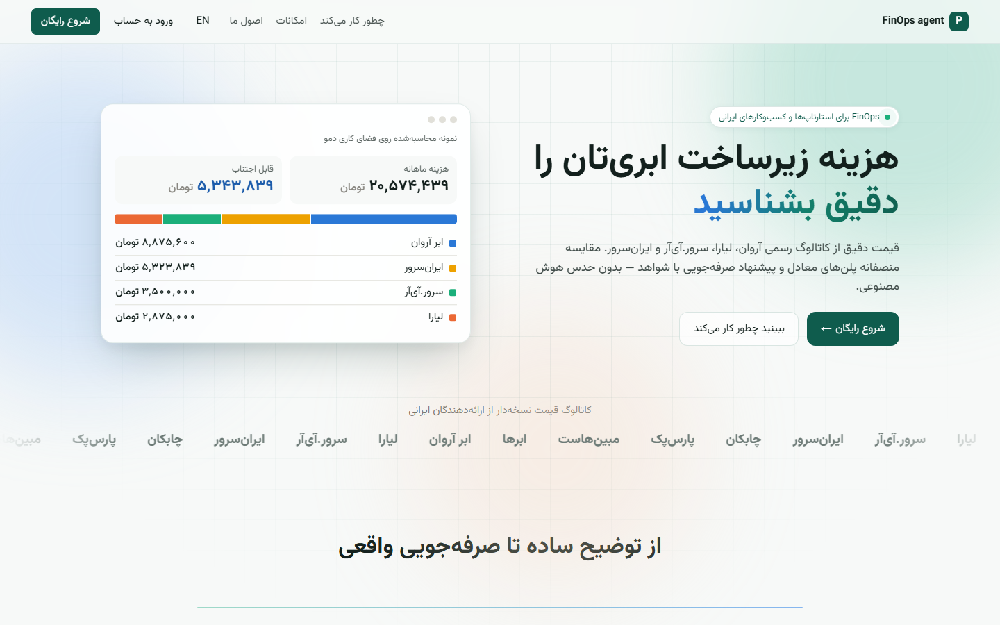 | 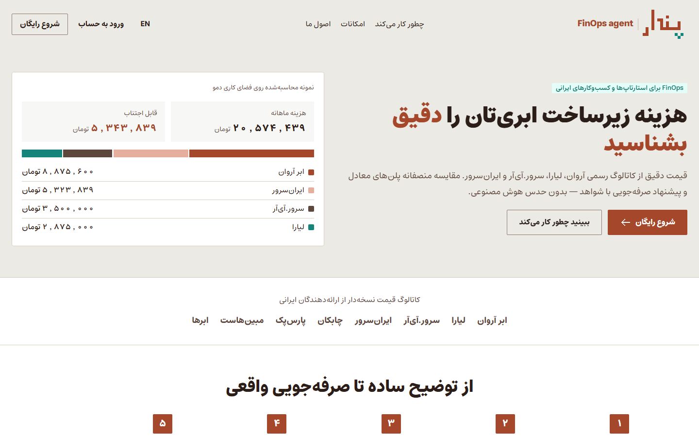 |
| Overview | 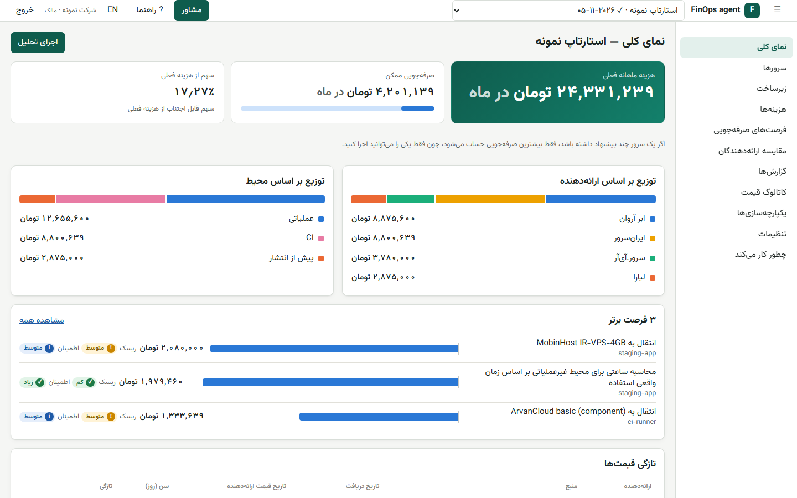 | 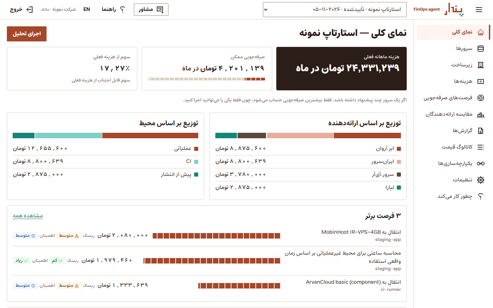 |
| Overview, dark | | 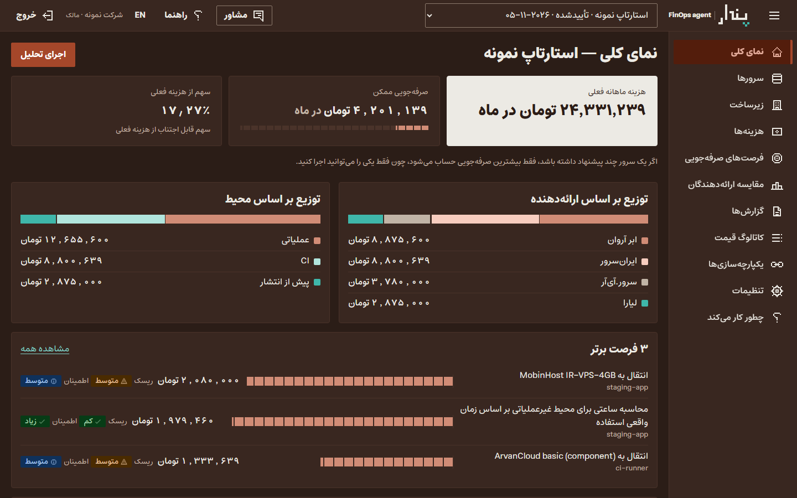 |
| Opportunities | 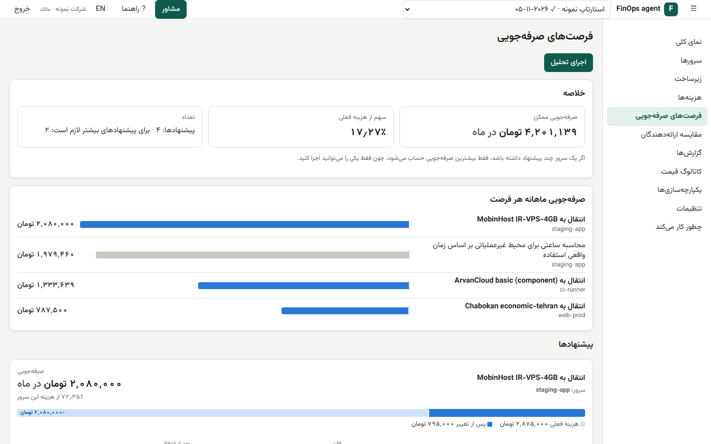 | 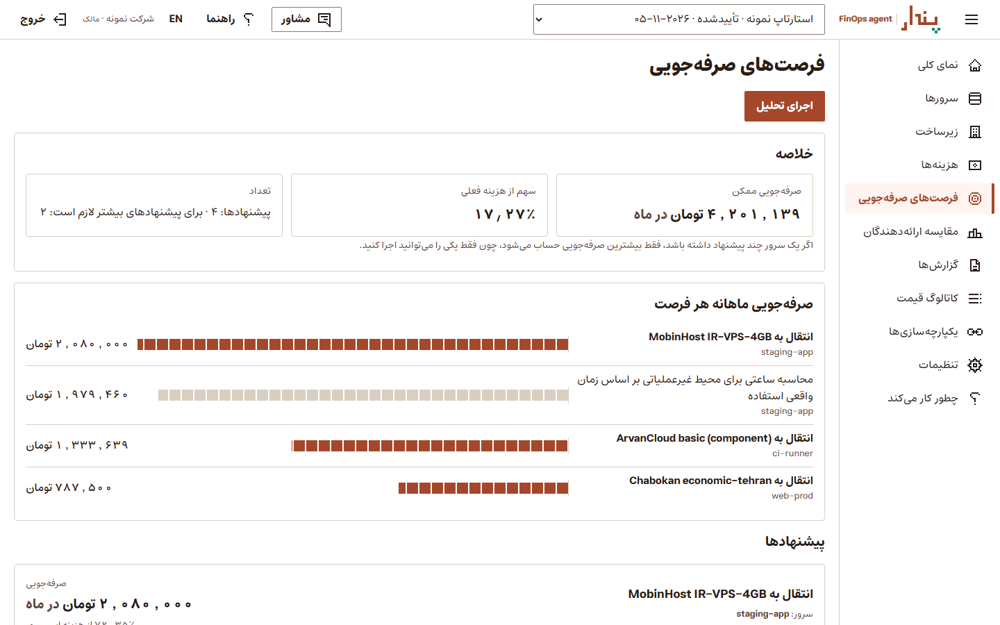 |

### Remaining issues

- **Dates are Gregorian.** The fields and voice guidelines ask for Solar Hijri dates in Persian, but the app still shows
  Gregorian dates with Persian digits. Changing how dates are formatted goes beyond a visual redesign, so it's left
  for a separate change.
- **Some text from the API stays English.** Sync statuses show as `OK`, `WARNING` and `FAILED`, and the demo
  workspace's note is in English.
- **The product name** is still "FinOps agent". It's set in `PRODUCT_NAME` (`components/Brand.tsx`), `appName`
  (`lib/i18n.tsx`) and `<title>` (`index.html`). A rename would also need Pendar's sub-brand in Specimen ("New
  sub-brand"), and an accent colour if the product wants its own tiles.
- **`@pendar/ui` isn't used,** because it needs Tailwind 4 and would be new dependencies. The app's own components
  are restyled to match it instead. Adopting the package later would replace them.
- **There is no theme switch.** The app never had one. Dark mode follows the system, and `data-theme` is supported.
- **Charts** use the brand ramps until Pendar publishes chart tokens.

## 4. Motion

Added after the redesign, following Pendar's motion guideline and the way pendarsolutions.ir moves. Pendar moves
"like a builder": things arrive and settle, several arrive one by one in reading order, and only loaders repeat. No
library was added. Everything is CSS on the motion tokens, plus two small pieces of script: one marks a landing section
the first time it scrolls into view, and one places the sliding tab line.

### What moves

| Where | What happens | Timing |
|---|---|---|
| Wordmark (landing, sign-in, How it works, app start) | Laid brick by brick in writing order, as in Pendar's animated logo; then the rule stands, the product name slides in from the wordmark's side, and the three tiles of «پ» glaze one by one | a brick every `--duration-lay`, each settling over `--duration-base` with `--ease-settle`; tiles `--glaze-gap` apart over `--duration-slow`; about 1.8s |
| Landing hero | After pendarsolutions.ir: the headline arrives word by word, then the lead, the actions and the preview (whose bars are laid last), and the navigation drops in at the end | `--duration-brand`, staggered from `--duration-stagger` |
| Landing sections | Rise once, item by item, the first time they scroll into view. Sections already in view on load wait for the hero, so everything arrives in reading order | `--duration-brand`, three staggers apart, no more than eight waiting |
| Landing closing band | A course of 16 bricks rises along its top edge and the statement lights up word by word, both following the scroll; its lockup is laid when it comes into view. On umber the logo is the reverse one | scroll-driven (`view-timeline`); where unsupported, the edge stands and the words rise once |
| App pages | A page's blocks arrive one by one when they first appear | `--duration-slow`, a stagger apart, eight at most |
| Side navigation | The brick marker stands up on the page you move to and drops, quicker, from the one you leave | `--duration-base` in, `--duration-exit` out |
| Tabs | The brick line slides to the chosen tab | `--duration-slow`, `--ease-standard` |
| Charts | Bars are laid in reading direction, one after another, instead of being stretched (stretching squashed the brick pattern) | `--duration-slow`, a stagger apart |
| Headline figures | Rise into place when they first show and whenever they change | `--duration-slow` |
| Tooltips, drawer backdrop | Tooltip comes up from slightly below; the backdrop fades in | `--duration-base` |
| Copy button | The tick is drawn in reading direction when the command is copied | `--duration-slow` |

### Reduced motion, print, and no script

With reduced motion on, nothing travels or waits: delays and durations are zero, the wordmark is whole with its tiles
glazed from the start, the closing edge stands, and the words are lit. Landing sections only wait out of sight while
the reveal script is running, so without it, and when printing, everything is simply there.

### Not done

- **No exit animations for the drawer or the tour.** They would delay unmounting, which changes when focus returns.
- **No skeletons, toasts or pull to refresh.** The app has none of these to animate. Waits keep the glazing wall.
- **The physical `left` on the tab line** is deliberate: the line is placed from measured, physical positions.

### Verification

- **Filmstrips.** A scripted browser pauses every animation and seeks it to fixed times:
  [`pendar-redesign/motion/`](pendar-redesign/motion/).
- **Motion checks,** 20, all passing:
    - the hero and the wordmark end fully in place, with the tiles glazed
    - sections below the fold wait, and all are revealed after scrolling
    - the closing edge and statement end complete
    - the English wordmark lays its 71 Latin bricks
    - the side bar marker is only on the current page, and the tab line ends under the chosen tab
    - under reduced motion everything is in place at once
    - no external requests, failed requests or console errors
- **Behaviour.** The 22 behaviour checks from the redesign pass again.
- **Overflow.** No horizontal overflow during or after the animations: landing, sign-in and How it works in Persian
  and English at 390px and 1440px, and six app pages at 390px.

| | |
|---|---|
| The wordmark laid (Persian) | 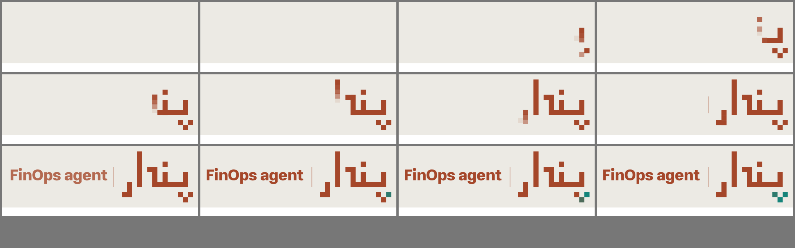 |
| Landing hero | 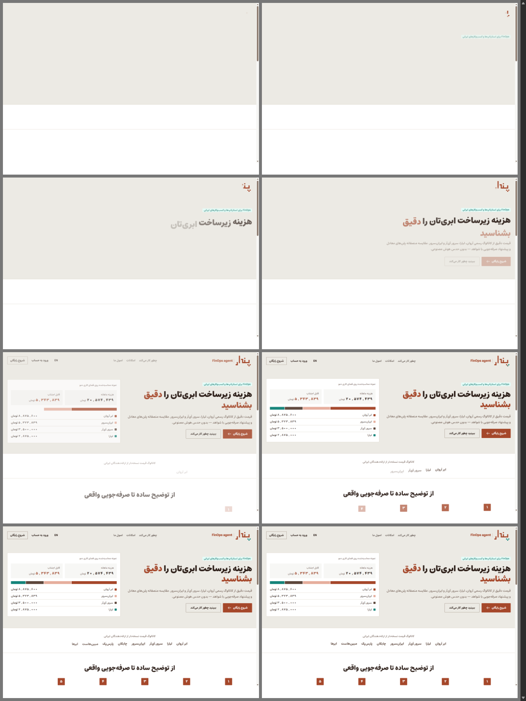 |
| Closing band on scroll | 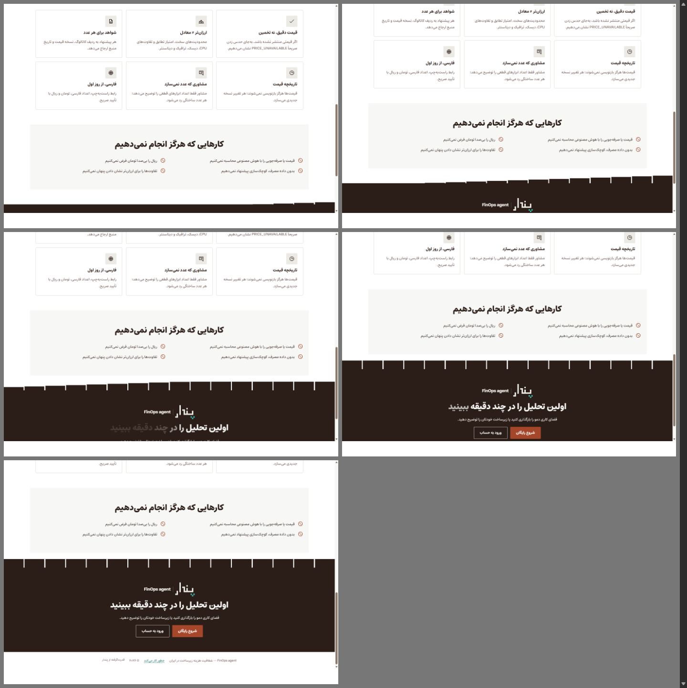 |
| Tab line | 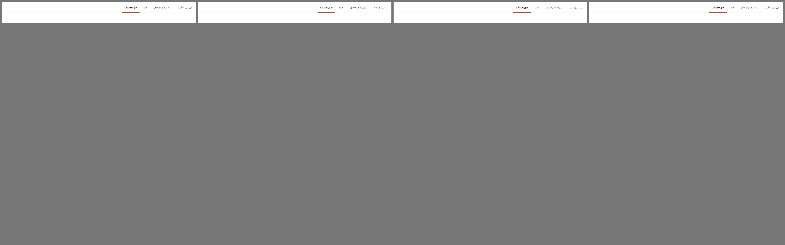 |

### Fixed on the way

On the dev server the welcome tour opened on every page load, even after it was dismissed. A dev-only helper read
`?tourStep=N` from the address, and when the parameter was missing `Number(null)` gave 0, so it opened the tour at
step 0. It now reads the parameter only when it is there. Production builds never ran that code.
